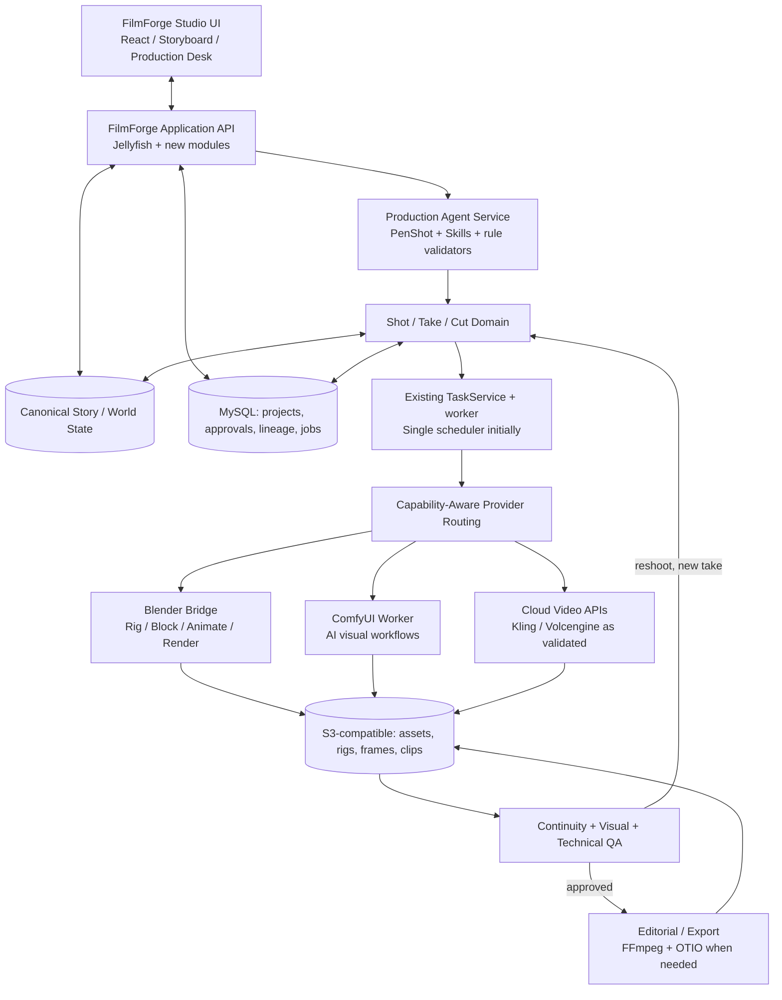

# FILMFORGE STUDIO — MASTER HANDOFF CONTEXT

> **Bản định hướng, phản biện kiến trúc và đặc tả triển khai cho coding agent**  
> **Phiên bản:** 1.0 · **Ngày chốt khảo sát:** 23/11/2026 · **Ngôn ngữ làm việc:** Tiếng Việt  
> **Trạng thái:** Quyết định kiến trúc có điều kiện; **CHƯA phải** mã nguồn đã merge hoặc hệ thống đã chạy thử toàn bộ.  
> **Người nhận handoff:** Chủ repo, CTO/tech lead, Codex, Claude Code hoặc AI coding agent.  
> **Đường dẫn đề xuất trong repo:** `docs/architecture/FILMFORGE_MASTER_HANDOFF.md`

---

## 0. QUICK START — ĐỌC TRƯỚC KHI VIẾT CODE

**Sứ mệnh:** Xây dựng **FilmForge Studio**, một hệ thống AI Film Production OS tự host, trước mắt phục vụ **phim hoạt hình tiên hiệp dài tập**, về sau hỗ trợ **phim điện ảnh 120–180 phút** với pipeline CGI/VFX + AI kết hợp.

**Không xây:** một giao diện chỉ nhập prompt rồi gọi video API; một bản “siêu merge” nguyên vẹn hàng chục repo; một model video mới từ đầu; hay hệ thống được hứa hẹn có thể một lần bấm tạo ngay 300 tập đạt chất lượng điện ảnh.

**Kiến trúc được chọn, có điều kiện:**

1. **Fork Jellyfish** làm **application foundation/MVP**: React + FastAPI + SQLAlchemy + MySQL + RustFS/S3-compatible storage + worker hiện hữu.
2. Xây **FilmForge Domain** làm lớp nghiệp vụ độc lập: Series, Season, Episode, Sequence, FilmShot, Take, Cut, Story Bible, Asset Revision, World State, Production Approval.
3. **Blender và asset/rig/reusable animation** là đường sản xuất ưu tiên của series tiên hiệp; ComfyUI và cloud video providers là công cụ bổ trợ theo shot.
4. PenShot và Drama Skills là lớp pre-production/agent tích hợp qua SDK, API hoặc skill registry. Toonflow là benchmark UX và nguồn port tính năng riêng lẻ, **không nhập toàn bộ Vue/Bun frontend**.
5. **Không thay queue, database hay frontend của Jellyfish trong PR đầu tiên.** Trước tiên chạy baseline và kiểm tra giới hạn thật. Hỗ trợ đa worker/distributed orchestration là giai đoạn sau.
6. Mỗi thay đổi phải giữ được **provenance, versioning, kiểm thử, license attribution, budget visibility và human approval**.
7. **Tiêu chí thành công sớm nhất:** tạo được pilot tiên hiệp 60–90 giây với cùng nhân vật trong nhiều shot, shot/take lineage, sửa một shot, continuity review và export; sau đó nâng lên 3–5 phút và hai tập liên tiếp.

**Chặn triển khai ngay nếu:** không bootstrap được foundation, không thiết lập được đầu ra video hợp pháp/được cấp quyền, hoặc không thể liên kết một asset version nhất quán với shot/take trong dữ liệu.

---

## 1. PRODUCT CHARTER — MỤC TIÊU VÀ PHẠM VI

### 1.1 Hai tầm nhìn sản phẩm

**A — Xianxia Animation Series OS (ưu tiên số 1)**

- Sản xuất nhiều season, hàng trăm tập tiên hiệp; có world lore, tông môn, cảnh giới, công pháp, pháp bảo, trang phục, diễn hoạt, giọng nói, bối cảnh và các trận chiến.
- Tạo/tái sử dụng **digital actors**, rigs, motions, environments, FX presets, audio/voice profiles.
- Quản lý biến đổi của nhân vật qua thời gian truyện; flashback dùng asset/state đúng thời điểm.
- Thiết kế cho sản xuất nhiều tập nhưng **chưa cam kết tạo tự động 300 tập**; sản lượng chỉ tăng sau khi có benchmark và nhân sự/phần cứng phù hợp.

**B — Cinematic Feature Film OS (ưu tiên số 2)**

- Phục vụ phim 120–180 phút với yêu cầu camera, staging, diễn xuất, CGI/VFX, sound và color pipeline cao.
- Cho phép kết hợp các shot dựng 3D/truyền thống, quay/footage có bản quyền, AI video và compositing.
- Không tuyên bố “đạt chuẩn Hollywood” chỉ bằng model hoặc API; chất lượng hoàn thành phụ thuộc đạo diễn, art team, diễn hoạt, âm thanh, hậu kỳ, compute và vòng phê duyệt.

### 1.2 Quy mô minh họa

- 300 tập × 20 phút/tập = **6.000 phút / 100 giờ** thành phẩm; ở trung bình 5–8 giây/shot, tương đương **45.000–72.000 shot** (chỉ là giả định thiết kế).
- Phim 150 phút × trung bình 5–8 giây/shot ≈ **1.125–1.800 shot**.
- Thực tế có thêm keyframe, version, retake, render passes, âm thanh, compositing và nhiều lần xuất bản; số tác vụ và lượng dữ liệu thường lớn hơn số shot cuối cùng rất nhiều.

### 1.3 North-star metric

**Chi phí và công sức để tạo một phút footage ĐƯỢC DUYỆT với continuity đúng, có khả năng chỉnh sửa và tái sản xuất.**

Không tối ưu riêng cho: số GitHub stars, số model tích hợp, số agent đang chạy hay thời gian ra clip đầu tiên.

### 1.4 Personas

- **Creator/Showrunner:** quyết định câu chuyện, canon, mùa/tập, ngân sách, duyệt storyboard/final cut.
- **Director/Storyboard Artist:** tạo shot grammar, lens/camera, blocking, action beats, coverage.
- **Animation/VFX TD:** quản lý rig, animation scenes, renderer, fx passes, render jobs.
- **Editor/Producer:** duyệt takes, cut, audio, subtitles, deliverables, version history.
- **Platform Engineer:** integrations, queues, reproducibility, security, costs, CI.

### 1.5 Ngoài phạm vi MVP

- Không train foundation video model riêng.
- Không lập render farm OpenCue đầy đủ từ ngày đầu.
- Không triển khai event sourcing cho mọi bảng dữ liệu hay microservice hóa toàn bộ.
- Không port 3D previs hoàn chỉnh của Toonflow ngay.
- Không làm social network, marketplace, billing đa tenant, mobile app trước khi pipeline có sản phẩm mẫu.
- Không tự nhận có mô hình đảm bảo identity 100% xuyên hàng nghìn shot.

---

## 2. HỘI ĐỒNG PHẢN BIỆN ĐA CHUYÊN GIA (MÔ PHỎNG)

> Đây là các **vai trò phản biện do AI mô phỏng**, không phải kết quả tham vấn từ những cá nhân/tổ chức độc lập. Phần này được thiết kế để cố gắng bác bỏ chính phương án đề xuất trước khi quyết định.

| Vai trò | Phản biện mạnh nhất | Quyết định/biện pháp bắt buộc |
|---|---|---|
| **Showrunner/Series Producer** | AI clip không hiểu canon hàng trăm tập. RAG trả lời sai hoặc lấy trạng thái nhân vật ở tập tương lai. | Story canon có cấu trúc, `StoryEvent` theo thời điểm, branch/retcon, approval; test hồi tưởng và thay cảnh giới. |
| **3D Animation Technical Director** | Video diffusion mỗi shot không giữ rig, diễn hoạt, camera và tài sản; sẽ quá tốn để render lại hàng chục nghìn shot. | Canonical character asset/rig + Blender scene; AI video là tùy chọn; kiểm thử asset reuse từ đầu. |
| **Film Director/Cinematographer** | Storyboard tạo đẹp không đồng nghĩa với logic phim: 180-degree rule, eyeline, action continuity, lighting, camera coverage. | Shot contract có shot type, lens/camera, blocking, duration, actor beats; human storyboard gate. |
| **VFX/Color Supervisor** | Một MP4 “trông đẹp” không đủ cho hậu kỳ; cần passes, editorial handles, source provenance, color management. | Asset manifest/footage specs, OCIO/shot color policy, VFX source links; OTIO cho editorial interchange, không coi OTIO là renderer. |
| **Agent/AI Architect** | Nhiều agent tự do tự gọi API sẽ gây mâu thuẫn dữ liệu, vòng lặp chi phí và prompt drift. | Agent chỉ đề xuất **typed artifacts** và gọi tool có quyền hạn; state changes qua domain service; approval + budget gates. |
| **Platform/SRE Engineer** | Jellyfish chỉ có một worker điều phối, không scale theo yêu cầu 100h series; gọi lại request khi timeout có thể bị tính tiền 2 lần. | Audit baseline worker, lưu remote ID, trạng thái không xác định cần reconcile; phase sau mới distributed scheduler/lease/outbox. |
| **Open-Source Maintainer** | Fork toàn bộ rồi ghép UI Python/React + TypeScript/Bun/Vue + Svelte sẽ làm build, schema, dependency bất khả duy trì. | Chỉ một canonical app; port module/API/skills khi có contract và tests; giữ upstream remote, SHA, attribution. |
| **Security/IP/Legal Reviewer** | CC-NC/Elastic/AGPL/GPL, model weights, character likeness, voice clone, script/IP chưa được kiểm tra. | License SBOM/NOTICE, kiểm tra quyền từng input/model, secret handling; commercial gate. Không coi nhận định này là tư vấn pháp lý. |
| **CFO/Operations/Product Lead** | Sản xuất 300 tập là giả định nhu cầu và chi phí chưa được chứng minh; tăng model count không giúp unit economics. | Pilot theo stage gate; log chi phí/giây được duyệt, failed-take ratio, worker efficiency, asset reuse; chỉ scale khi pass. |

### 2.1 Ý kiến bất đồng quan trọng

**Dissent A — “Toonflow nên làm foundation vì 3D previs và infinite canvas.”**  
**Đúng khi:** sản phẩm ưu tiên visual UX, desktop/local experience, 3D previs và lập trình TypeScript/Bun/Vue.  
**Lý do vẫn nghiêng Jellyfish:** backend production contract, task service, workflow review và code Python thuận lợi tích hợp Blender/PenShot.  
**Quyết định có điều kiện:** sau bootstrap, nếu proof-of-concept screenplay → episode → shot → take → edit với Jellyfish không đạt **Gate 0** hoặc buộc sửa quá sâu các entity lõi, chạy một spike tương đương trên Toonflow trước khi khóa nền dài hạn. Không dùng số star để thay kỹ thuật.

**Dissent B — “Nên viết mới lõi sạch từ đầu thay vì fork Jellyfish.”**  
**Đúng khi:** schema/story concepts của Jellyfish không mở rộng được, migration quá phức tạp, hoặc architecture buộc phải giữ hai hệ thống production state.  
**Quyết định:** fork để kiểm chứng nhanh, giữ lõi upstream dưới abstraction; phần FilmForge mới sử dụng domain API rõ ràng. Nếu bị chặn, có thể trích xuất domain vào service/repo riêng sau. Không rewrite trước khi có bằng chứng.

**Dissent C — “Muốn 300 tập phải triển khai USD + OpenCue + distributed GPU farm ngay.”**  
**Phản biện:** overengineering sẽ trì hoãn kiểm chứng một shot có thể điều khiển và tái sử dụng asset hay không.  
**Quyết định:** dùng `.blend` và manifest có version cho pilot; OpenUSD cho trao đổi scene khi cần; OpenCue chỉ ở giai đoạn nhiều GPU/máy và Blender render thực sự là nút thắt.

**Dissent D — “Chỉ cần text-to-video đa model, không cần CGI.”**  
**Phản biện:** khó duy trì hình thể, camera, action choreography, rigging và retake khi quy mô hàng nghìn shot.  
**Quyết định:** thử song song đường AI-video và đường 3D trong pilot; với recurring characters, mặc định ưu tiên asset-based hoặc reference-constrained workflow. Chọn đường nào dựa trên phép đo chi phí/quality, không giáo điều.

### 2.2 Biên bản quyết định cuối hội đồng

**ACCEPT WITH CONDITIONS** — chọn kiến trúc **Hybrid Animation/VFX Production OS**, fork Jellyfish để khởi đầu, thiết kế dữ liệu world-state và asset version ngay, không merge nguyên repo, triển khai theo milestone và gate. Không coi bất kỳ công nghệ nào là vĩnh viễn nếu phép thử loại trừ nó.

---

## 3. SOURCE REPOSITORY MATRIX VÀ CHÍNH SÁCH FORK

### 3.1 Nguồn đã đối chiếu ngày 23/11/2026

| Repository | License chính theo repo | Vai trò | Tình trạng nhập code | Bằng chứng kỹ thuật |
|---|---|---|---|---|
| [Forget-C/Jellyfish](https://github.com/Forget-C/Jellyfish) | Apache-2.0 | **Application foundation** | Fork với lịch sử và giữ upstream; đổi có điều kiện | `backend/app/core/contracts`, `app/services/directing`, `app/task_worker.py`, `front/`, docs task execution |
| [HBAI-Ltd/Toonflow-app](https://github.com/HBAI-Ltd/Toonflow-app) | MIT | UX/previs, infinite canvas, MCP | Research fork; port component riêng sau compatibility test | Vue/Bun/TS, 3D previs, canvas, agent features |
| [neopen/story-shot-agent](https://github.com/neopen/story-shot-agent) | MIT | Pre-production script → structured shots | Python SDK/REST sidecar, không merge app | PenShot mô tả là declarative shot planning, không phải video renderer |
| [zenstory-ai/drama-skills](https://github.com/zenstory-ai/drama-skills) | MIT | Agent skills: screenplay, asset, storyboard, review | Copy có chọn lọc và attribution; schema normalize | `skills/*/SKILL.md`, tests và validators |
| [eternityspring/shuohao-skills](https://github.com/eternityspring/shuohao-skills) | Apache-2.0 | Character references, writing, art bible | Select skills, evidence/provenance | `skills/novel-*`, `skills/character-refs` |
| [alibaba/lumenx](https://github.com/alibaba/lumenx) | MIT | Model catalog, provider adapters, prompt assembly | Port adapter pattern có tests; không lấy app | `src/models/`, `src/apps/comic_gen/` |
| [benjiyaya/Calliope](https://github.com/benjiyaya/Calliope) | MIT | ComfyUI workflow adapter / local AI | Optional isolated adapter | `calliope-backend/src/calliope/comfyui/` |
| [Comfy-Org/ComfyUI](https://github.com/Comfy-Org/ComfyUI) | GPL-3.0 | AI image/video local runtime | Giao tiếp API bên ngoài; không nhúng source vào lõi | API, workflows, custom nodes |
| [Blender](https://projects.blender.org/blender/blender) | GPL family; kiểm tra bản phân phối | 3D modeling, rigging, animation, rendering | DCC/tool ngoài, Blender Python bridge | Official Blender Pipeline docs |
| [Blender Studio Tools](https://projects.blender.org/studio/blender-studio-tools) | Kiểm tra từng thành phần | Asset pipeline, Shot Builder | Tham khảo/pilot addon riêng | Official Blender Studio docs |
| [OpenTimelineIO](https://github.com/AcademySoftwareFoundation/OpenTimelineIO) | Apache-2.0 | Editorial timeline **interchange** | Adapter / thư viện riêng | OTIO ≠ engine render |
| [OpenCue](https://github.com/AcademySoftwareFoundation/OpenCue) | Apache-2.0 | Render farm | Defer; external integration | Chỉ khi multi-host GPU/CPU rendering cần |
| [OpenUSD](https://github.com/PixarAnimationStudios/OpenUSD) | TOST 1.0 trong LICENSE nguồn kiểm tra | 3D scene interchange/layering | Defer; đánh giá license và compatibility | Không đồng nghĩa bắt buộc dùng từ MVP |
| [OpenColorIO](https://github.com/AcademySoftwareFoundation/OpenColorIO) | BSD-3-Clause | Color pipeline | Sử dụng khi hậu kỳ cần | External library/pipeline |

**Không nhập code trực tiếp theo mặc định:** [OpenMontage](https://github.com/OpenMontageInc/OpenMontage) (AGPL-3.0), [NodeTool](https://github.com/nodetool-ai/nodetool) (AGPL-3.0), [Nomi](https://github.com/aqm857886159/Nomi) (AGPL-3.0), [Huobao Drama](https://github.com/chatfire-AI/huobao-drama) (file LICENSE CC BY-NC-SA 4.0), [waoowaoo](https://github.com/waooAI/waoowaoo) (Elastic License 2.0). Chỉ tham khảo kiến trúc hoặc xử lý qua giấy phép tương thích với mục đích sử dụng thực tế.

**Lưu ý:** License repo không cấp đương nhiên quyền đối với sample video/images, model weights, pretrained checkpoints, tên/diện mạo nhân vật hoặc bên cung cấp API. Phải rà dependency + asset + model riêng.

### 3.2 Pin upstream snapshot để tránh trôi phiên bản

Sau đây là SHA quan sát khi khảo sát; **trước khi bắt đầu phải `git fetch` và ghi lại SHA thực tế đã chọn trong `docs/upstreams/manifest.yaml`**.

```yaml
upstreams:
  jellyfish:
    repo: https://github.com/Forget-C/Jellyfish.git
    branch: main
    observed_sha: b1d8add653a97ebe89c2eb8cc7b712af800b8f3c
    role: foundation
  toonflow:
    repo: https://github.com/HBAI-Ltd/Toonflow-app.git
    branch: master
    observed_sha: eecf51547af47eb504822186bd3f2dee369125ff
    role: research_ui_previs
  penshot:
    repo: https://github.com/neopen/story-shot-agent.git
    branch: main
    observed_sha: 54fea30a2d8aea9f47f069545c97899077b5eb20
    role: optional_service
  drama_skills:
    repo: https://github.com/zenstory-ai/drama-skills.git
    branch: main
    observed_sha: 7fed9dfcd33c5a3134ff1b51709dd826488b5aab
    role: selected_skills
  shuohao_skills:
    repo: https://github.com/eternityspring/shuohao-skills.git
    branch: main
    observed_sha: 8af10e0ea1a550e4575666884f4deef780bf38ff
    role: selected_skills
  lumenx:
    repo: https://github.com/alibaba/lumenx.git
    branch: main
    observed_sha: f2a02e23171447c939e7d8e1386b24d17049bbf1
    role: provider_reference
  calliope:
    repo: https://github.com/benjiyaya/Calliope.git
    branch: main
    observed_sha: 32bcd92f3826bd8c10219aebf4cebefbff116eaf
    role: comfyui_reference
```

### 3.3 Quy tắc fork/merge

1. **Một GitHub repo chính** (`YOUR_USERNAME/filmforge-studio`) fork từ Jellyfish, giữ lịch sử và `upstream` remote.
2. Các repo khác được fork/clone riêng để học; không khai báo 6 remote rồi `git merge --allow-unrelated-histories` toàn bộ vào `main`.
3. Import qua **service adapter**, **package độc lập** hoặc **port file cụ thể**, kèm commit nguồn và license.
4. Với code import: lint/typecheck/unit tests, documentation, provenance, security scan và integration tests trước khi merge.
5. `LICENSE`, `THIRD_PARTY_NOTICES.md`, `docs/upstreams/manifest.yaml` và danh sách software/model assets phải cập nhật cùng PR.
6. Công cụ GPL/AGPL/TOST nên được tích hợp theo ranh giới độc lập và kiểm tra legal khi đóng gói/phân phối/hosted commercial; không dựa trên giả định “dùng API là chắc chắn miễn mọi nghĩa vụ”.

---

## 4. TECHNICAL REALITY CHECK — CÁI GÌ ĐÃ CÓ, CÁI GÌ CHƯA

### 4.1 Jellyfish: các sự thật đã thấy trong mã/tài liệu

- **Existing stack:** FastAPI, LangChain/LangGraph, SQLAlchemy, frontend React/Vite; backend `uv`.
- **Triển khai hiện tại:** Compose sử dụng **MySQL 9, RustFS/S3-compatible storage, backend API và một task-worker**; local có các lựa chọn dev khác, nhưng không mặc định đổi sang PostgreSQL.
- **Existing canonical production chain:** `Project → Chapter → Sequence → Scene Version → Production Unit → Task → Take → Timeline/Delivery`; `Sequence` là narrative scene, khác `Scene` như location asset.
- **Các bảng legacy Shot/ShotDetail và một số 4-canvas workflows đã nghỉ dùng.** Không được viết module mới dựa trên file/tên cũ chỉ vì tìm thấy tài liệu lịch sử.
- **Task source of truth** là `tasks.status`, lifecycle qua `TaskService`; states là `queued/running/succeeded/failed/cancelled`. Stage chi tiết là thuộc tính phụ, **approval/review không phải task status**.
- **Worker limitation:** theo tài liệu ngày khảo sát chỉ **một tiến trình scheduler worker** cho một DB. Remote ID có thể được poll sau restart; local steps/DAG tùy ý không có generic checkpoint. Submission bị ngắt trước khi ghi remote ID có nguy cơ trạng thái không xác định; không tự động retry nếu có nguy cơ tính phí 2 lần.
- **Existing provider key:** `openai`, `volcengine`, `vidu`, `kling` trong `backend/app/core/contracts/provider.py`; **không coi danh sách quảng cáo model của repo khác là quyền truy cập API thật**.
- **Existing API client:** frontend sử dụng OpenAPI generated client; mọi route/schema mới cần cập nhật contract.
- **Existing source code** chỉ chứng tỏ đã có thiết kế/triển khai ở mức nhất định; chưa có smoke test hệ thống của FilmForge hoặc test video thực.

**Bằng chứng:**

- [Task execution architecture — pinned](https://github.com/Forget-C/Jellyfish/blob/b1d8add653a97ebe89c2eb8cc7b712af800b8f3c/docs/development/architecture/task-execution.md)
- [Data model — pinned](https://github.com/Forget-C/Jellyfish/blob/b1d8add653a97ebe89c2eb8cc7b712af800b8f3c/docs/development/reference/data-model.md)
- [Local development — pinned](https://github.com/Forget-C/Jellyfish/blob/b1d8add653a97ebe89c2eb8cc7b712af800b8f3c/docs/development/guides/local-development.md)
- [Directing foundation — pinned](https://github.com/Forget-C/Jellyfish/blob/b1d8add653a97ebe89c2eb8cc7b712af800b8f3c/docs/development/architecture/directing-foundation.md)
- [Provider contract — pinned](https://github.com/Forget-C/Jellyfish/blob/b1d8add653a97ebe89c2eb8cc7b712af800b8f3c/backend/app/core/contracts/provider.py)
- [Current task worker — pinned](https://github.com/Forget-C/Jellyfish/blob/b1d8add653a97ebe89c2eb8cc7b712af800b8f3c/backend/app/task_worker.py)

### 4.2 Existing vs Planned — tuyệt đối không đánh đồng

| Capability | Existing ở Jellyfish (cần chạy kiểm chứng) | FilmForge cần xây thêm |
|---|---|---|
| Script/chapter, scene/workspace | Có domain và API | Series/season/episode continuity, narrative event ledger |
| Storyboard/take/review | Có scene/version, production units/takes và review | FilmShot identity ổn định, shot dependency và final acceptance policy |
| Provider | Đã có một số adapters | Capability matrix, price/budget governance, local ComfyUI, validated fallback |
| Task worker | DB-backed single scheduler, poll remote | Crash-safe reconciliation, multi-worker ownership/lease khi scale |
| Character/location references | Có references/assets | Digital asset registry, versioned rig/motion/voice và temporal story state |
| Editorial/export | Có một số chức năng timeline/export | OTIO adapter, audio/FX tracks, feature-film conform/versioned cut |
| Agent | Có LangGraph và tasks | Typed crew skills, role permissions, approval, anti-loop cost gates |
| 3D animation/VFX | Không phải production 3D engine | Blender bridge, rig publishing, shot assembly, render manifest |
| Render farm | Chưa phải nhu cầu đầu | OpenCue hoặc một scheduler phù hợp sau khi pass scale gate |

---

## 5. TARGET ARCHITECTURE

### 5.1 Sơ đồ logic



### 5.2 Bounded contexts

| Context | Single source of truth | Nhiệm vụ |
|---|---|---|
| **Story Canon** | Typed story records + approved events | World rules, character arcs, factual narrative, branch/retcon |
| **Digital Assets** | Asset ID/revision + immutable file identity | Character rig, wardrobe, models, mocap, environment, VFX, voices |
| **Pre-production** | Approved screenplay/scene/shot revisions | Shot list, storyboard, blocking, references |
| **Production** | Task/Take provenance, job history | Provider dispatch, clip/scene generation, 3D job, cost/retry |
| **Editorial** | Cut revision + approved references to takes | Timeline, transitions, music/voice/subtitle, final export |
| **Governance** | Review/approval events, license ledger, audit logs | Gating, access, cost, rights and release evidence |

**Không tạo hai bảng nguồn sự thật cùng một loại:** ví dụ trạng thái paid-job phải do TaskService hiện có ghi, UI không trực tiếp sửa `Task.status`. Canon không được lưu riêng trong prompt text và DB không đồng bộ.

### 5.3 Hai production modes chung domain

**Mode 1 — Animated Xianxia Series**

1. Story/World Bible + episode script.
2. Character asset/rig/wardrobe/motion/VFX preset đã được publish.
3. Shot planning, previs/blocking trong Blender hoặc UI tích hợp.
4. Dựng animation/pose/camera/lighting trong scene file chuẩn và tạo preview.
5. AI assists: concept, textures, voices, background plates, VFX layers hoặc special shot khi model đáp ứng reference.
6. Review + accepted take + cut + final export.

**Mode 2 — Cinematic Feature**

1. Screenplay + scene beats + character/camera/VFX breakdown.
2. Lên kế hoạch mức độ dựng thật: 3D, footage, AI shot, compositing hay combination.
3. Production tracking và editorial handoff.
4. Color management, sound post, VFX provenance, conform kiểm tra.

**Không ép tất cả shot đi qua cùng video model.** Từng shot có `production_method = animation_3d | ai_video | compositing | footage | hybrid`.

### 5.4 MVP architecture: modular monolith trước, services sau

- Giữ `backend/`, `front/`, `deploy/` của Jellyfish.
- `backend/app/services/filmforge/` chứa domain services mới; `backend/app/core/contracts/filmforge/` chứa Pydantic contracts.
- `backend/app/core/integrations/` chứa adapters, không để provider gọi thẳng DB.
- `front/src/features/filmforge/` chứa phần UI mới, sử dụng generated API client.
- Nếu PenShot không thể import an toàn: dùng Python process / HTTP sidecar; không bắt buộc microservice ngay.
- Blender chạy như external executable/headless process hoặc worker tách biệt có manifest; không chạy Blender hoặc FFmpeg lâu trong transaction.
- Tránh tự tạo queue thứ hai trong Phase 1. Sau khi xác nhận worker limitation, xem Phase Scale.

---

## 6. CANONICAL DOMAIN & DATA CONTRACT

### 6.1 Nguyên tắc domain bắt buộc

1. **Identity ổn định, revision bất biến:** ID nhân vật/shot không thay đổi khi tạo take mới; version mới không ghi đè nguồn cũ.
2. **Narrative state ≠ Visual asset:** Character có `story_state` (cảnh giới, thương tích, quan hệ) khác `visual_asset_revision` (rig, tóc, trang phục).
3. **Shot plan ≠ Take ≠ Final cut:** Shot mô tả ý định; Take là ứng viên được tạo; Cut là quyết định biên tập dùng một đoạn của Take.
4. **Canon theo thời điểm:** biết sự thật nào có hiệu lực ở tập/cảnh nào; flashback hoặc retcon phải truy vấn theo narrative time và canon branch.
5. **Approved evidence:** AI output là bản nháp; không tự thêm vào canon/timeline đã khóa khi chưa có quyền.
6. **Media provenance:** mọi output truy được task, provider/model, config hash, license/usage policy, input assets và storyboard revision.

### 6.2 Đối tượng domain mới tối thiểu

```text
FilmProject (type: series | feature)
  ├── Season (series only)
  │     └── Episode
  │           └── Sequence (narrative scene)
  │                 └── FilmShot
  │                       ├── StoryboardRevision
  │                       ├── ShotPlanRevision
  │                       └── Take[]
  │                              └── ProductionJob / InputManifest
  └── FeatureCut (feature only)

StoryBible
  ├── Character
  ├── Location
  ├── Prop / Artifact
  ├── CultivationRealm / PowerRule
  ├── Sect / Faction
  └── StoryEvent / CanonBranch / StateSnapshot

DigitalAsset
  └── AssetRevision
        ├── model / rig / wardrobe / motion / voice / VFX / reference
        └── file_id / checksum / usage_rights / tool_version

Editorial
  ├── CutRevision
  ├── TimelineItem (Take + source range)
  ├── Review / Approval
  └── Deliverable
```

**Tương thích Jellyfish:** không được tạo `FilmShot` độc lập nếu nó trùng quyền ghi của `Production Unit` hiện hữu. PR phân tích model phải tạo tài liệu mapping `existing sequence/production-unit/take ↔ filmforge shot/take` rồi mới quyết định thêm bảng hay thêm lớp projection. Tên `FilmShot` chỉ là tên miền ý nghĩa của sản phẩm, **không phải yêu cầu lập tức tạo table mới**. Legacy `Shot` trong Jellyfish đã bị retire, tuyệt đối không revive âm thầm.

### 6.3 Story-event ledger (thực dụng, không overengineer)

`StoryEvent` tối thiểu:

```json
{
  "event_id": "evt_e01s03_001",
  "project_id": "proj_xianxia",
  "canon_branch": "main",
  "subject_id": "char_hero",
  "event_type": "cultivation.breakthrough",
  "narrative_episode": 47,
  "narrative_sequence": "EP047_SC03",
  "payload": {"from": "realm_a", "to": "realm_b"},
  "status": "approved",
  "supersedes_event_id": null,
  "recorded_at": "2026-11-23T00:00:00Z"
}
```

Đây là ví dụ **proposed schema**. `recorded_at` là thời gian nghiệp vụ ghi nhận; `narrative_episode/sequence` là thời gian có hiệu lực trong truyện. Hai trục thời gian phải tách nhau. Retcon có branch/supersede và review; không sửa lịch sử bằng ghi đè lặng lẽ. Bản MVP chỉ triển khai loại event phục vụ pilot: đổi trang phục, nhận pháp bảo, thay cảnh giới, bị thương/hồi phục; chưa phải general-purpose event sourcing.

### 6.4 Asset revision

Mỗi `AssetRevision` cần `id`, `asset_id`, `semantic_version`, `asset_kind`, `file_id`, `checksum`, `dependencies`, `published_at`, `approved_by`, `source_tool`, `tool_version`, `license/provenance`, `compatible_character_id`. Với Blender, `.blend` là asset nguồn thực dụng; có thể xuất USD/glTF khi cần interchange, nhưng format xuất không được thay thế bản nguồn. Dùng checksum để xác minh và cache render, không dựa trên filename.

### 6.5 Shot contract (minh họa)

```json
{
  "shot_id": "EP001_SC03_SH007",
  "project_id": "project-001",
  "episode_id": "episode-001",
  "sequence_id": "sequence-003",
  "shot_revision": 2,
  "duration_target_s": 6.0,
  "production_method": "animation_3d",
  "characters": [
    {"id": "char-hero", "story_state_ref": "state-hero-e1s3", "asset_revision_id": "rig-hero-v3"}
  ],
  "location_asset_revision_id": "loc-mountain-v2",
  "camera": {"shot_size": "medium", "movement": "dolly_in", "lens_mm": 50},
  "action_beats": ["hero raises the sword", "energy begins to glow"],
  "required_capabilities": ["reusable_character_asset", "controlled_camera"],
  "reference_file_ids": ["file-storyboard-007"],
  "upstream_revision_hash": "sha256-of-locked-inputs",
  "approval_status": "storyboard_approved"
}
```

JSON chỉ mô tả hướng contract; model ID, trường thực tế, default values và quan hệ với Jellyfish phải được xác nhận qua schema/tests. Không truyền bí mật hoặc signed URL dài hạn trong contract lưu trữ.

### 6.6 Take, Cut và dependency invalidation

- **Take**: ứng viên bất biến từ một task/run; chứa `shot_id`, `shot_revision`, `asset_revision_ids`, `model`, `parameters`, `render_method`, `file_ids`, `cost`, `QA`, `created_at`.
- **Cut**: versioned timeline; mỗi item trỏ `take_id` và `source_start/source_end`, `timeline_start`, audio/subtitle/transition.
- **Approval**: review record riêng `target_type/id/revision`, `reviewer`, `decision`, `notes`; không sửa Task succeeded thành approved.
- **Stale invalidation**: khi asset/shot/character state thay đổi, đánh dấu **downstream consumers chịu ảnh hưởng**, không xóa media cũ và không tự render toàn bộ.
- **Snapshot isolation:** job đang chạy dùng frozen inputs đã duyệt; thay đổi storyboard trong lúc render sẽ tạo revision mới, không thay nghĩa job cũ.

---

## 7. MULTI-AGENT CONTRACT — KHÔNG PHẢI TÁM CHATBOT TỰ DO

### 7.1 Roles và output

| Logical role | Input | Typed output | Quyền |
|---|---|---|---|
| Showrunner | brief, canon | season arc, episode outline | đề xuất; owner duyệt |
| Screenwriter | series bible, episode plan | screenplay revision | đề xuất |
| World/Continuity Supervisor | canon events, shot plan | violations, affected state refs | đọc canon, tạo QA findings |
| Character/Art Director | approved canon + moodboard | asset brief, model/rig reference package | đề xuất asset revisions |
| Film Director | script, assets, constraints | shot plan, camera/blocking list | đề xuất/duyệt storyboard theo vai trò |
| Animation/Render Producer | shot spec, provider capabilities | task plan, estimate, render method | submit sau budget/approval gate |
| Film Editor | accepted takes, dialogue | cut revision, editorial notes | tạo cut draft |
| QA/Delivery Supervisor | cut + evidence | technical report, continuity report | khuyến nghị accept/reject |

Dùng orchestrator ít agent instances cần thiết, thay vì duy trì tám LLM gọi nhau mọi lúc. Agent không được SQL write trực tiếp; phải gọi domain tool với permission và expected revision. Skills là workflow template, không tự nhiên trở thành sự thật khi agent phát biểu.

### 7.2 Approval gates

```text
idea → script draft → APPROVE CANON/SCRIPT
     → assets & shot plan → APPROVE STORYBOARD
     → preflight references + budget → RENDER
     → QA + human review → ACCEPT/RESHOOT
     → cut draft → APPROVE CUT
     → package/encode/export → RELEASE
```

Bắt buộc chỉ rõ ai có quyền cho phép chi phí phát sinh; `auto-approve` (nếu có) phải có spend cap và role restriction. Không tự động xuất bản các kết quả chưa rõ quyền sử dụng.

---

## 8. VIDEO PROVIDER & BLENDER INTEGRATION DESIGN

### 8.1 Capability registry thay vì model list tĩnh

Mỗi provider+model entry phải có:

- `provider`, `model`, `operation_type`, `auth_region` và `verified_at`.
- `text_to_video`, `image_to_video`, `first_frame`, `last_frame`, `multi_reference`, `subject_reference`, `video_extend`, `native_audio`, max frames/seconds/resolution, aspect ratio, codec.
- `price_quote/estimate`, `currency`, `quota`, `rate_limit`, queue latency và rights/terms metadata.
- `supported` phải chia **advertised**, **adapter_implemented**, **credential_verified**, **smoke_test_passed** — chỉ loại cuối được dùng trong auto routing cho production.

### 8.2 Provider job state

Không thay thế TaskService hiện có mà tạo một lớp business projection lên trên các trạng thái của nó. Khả năng mới cần: submit intent/fingerprint, preflight, reserve estimate, provider request tracking, unknown-submission state, audit trail, reconcile actual cost, safe retry policy.

**Phương pháp chống duplicate charge:**

1. Ghi request intent và hash trước khi gọi API, lock quyền submit.
2. Gọi provider một lần; ghi remote ID càng sớm càng tốt.
3. Khi timeout nhưng chưa biết provider đã nhận hay chưa, đánh dấu **UNCERTAIN** ở business-level và **reconcile** qua API/query/support nếu có; không auto-submit lại một request billable.
4. `cancel` trong ứng dụng chỉ chắc chắn là hủy local tracking nếu provider không hỗ trợ cancel thật.
5. `retry` tạo attempt/Task mới có relation với task cũ, nhưng phải có điều kiện rõ ràng và budget approval.

Tài liệu Jellyfish nêu single worker + local noncheckpoint; việc biến nó thành worker cluster cần **ADR riêng** và contract rõ ràng chứ không thể chỉ tăng replicas Docker Compose.

### 8.3 Provider pilot

- Chọn **hai video providers thật sự có API key và quota** từ các adapters đã tồn tại, ưu tiên ví dụ `kling` và `volcengine` **nếu quyền truy cập được xác nhận**.
- Tối thiểu test: submit → poll → download → S3 store → shot take → review → export; kiểm tra reference first/last frame thực sự hoạt động với đúng model.
- Không route fallback sang model thiếu capability bắt buộc. Có phương án human-approved fallback nếu model đặc biệt không có thay thế.
- Ghi unit cost và quality evidence; không tự suy luận giá từ quảng cáo hoặc từ model tên gần giống.

### 8.4 Blender bridge

**Pilot có thể bắt đầu bằng subprocess/headless Blender hoặc một worker Python riêng**, không cần render farm:

- Input: asset refs/rig revisions + shot/camera/lighting/blocking manifest + pinned Blender version.
- Process: assemble `.blend` → validate missing dependencies → playblast/preview → final render/FX passes.
- Output: media + preview + logs + app/camera/scene metadata + checksum + duration/resolution/fps/color-space + warnings.
- Asset publish không ghi đè rig đã dùng trong một shot đã approved.
- Blender file/script được coi là untrusted nếu do bên ngoài tải lên; sandbox worker và chặn tùy tiện truy cập keys/network.
- Không dùng USD làm bắt buộc với pilot; thiết kế exporter/importer khi asset handoff đa DCC thực sự cần.

### 8.5 Render farm và editorial

- **OpenCue**: cân nhắc khi nhiều host/GPUs, queued Blender frames và rendering utilization trở thành pain point. Không dùng OpenCue để thay toàn bộ orchestration của cloud video API.
- **OpenTimelineIO**: dùng để biểu diễn/exchange edit decisions; giữ source of truth CutRevision trong DB, có OTIO export/import. OTIO không render video.
- **FFmpeg**: làm export/encode, technical QC; màu sắc/âm thanh phức tạp có thể cần công cụ DCC/NLE riêng.
- **OpenColorIO**: chuẩn hóa khi chuyển nhiều renderer/color spaces; xem là một nhiệm vụ production chuyên biệt, không phải một checkbox mặc định.

---

## 9. CONTINUITY SYSTEM — KHẢ NĂNG THẬT VÀ GIỚI HẠN

### 9.1 Các chiều continuity

1. **Narrative/world continuity:** lịch sử, timeline, cảnh giới, chiêu thức, quyền sở hữu pháp bảo, quan hệ, địa điểm.
2. **Character visual continuity:** khuôn mặt, dáng người, tóc, phục trang, rig/material revisions.
3. **Scene continuity:** ánh sáng, thời tiết, staging, prop positions, hành động giữa shot, scene geometry.
4. **Cinematic continuity:** eyeline, screen direction, 180-degree rule, lens/camera, pose transitions, action matching.
5. **Temporal/audio continuity:** thoại, nhịp âm thanh, voice identity, lipsync, subtitles, clip timing.

### 9.2 Kiểm tra nhiều lớp

- **Deterministic rules:** character state theo tập/cảnh, asset version, prop ownership, time invariants, shot revision/dependencies, fps/duration, missing media.
- **Vision/video analysis:** frame samples, visual embeddings/vision LLM cho nhận dạng và trang phục; tạo report với evidence frames/timecodes, không dùng score làm quyết định tuyệt đối.
- **Human review:** duyệt các trường hợp kịch tính, diễn xuất, continuity khó, quality bar.

**Giới hạn:** image reference, RAG, embedding và continuity agent **không bảo đảm** nhân vật giữ nguyên qua mọi model/shot. Dựng 3D/rig có thể khóa một số yếu tố hình học tốt hơn, nhưng vẫn cần kiểm tra motion, expressions, sound và compositing.

### 9.3 Rule tests dùng xuyên suốt

- Tập 47 nhân vật tăng cảnh giới; tập 48 dùng trạng thái mới.
- Flashback về tập 20 vẫn dùng trạng thái lịch sử.
- Shot A→B cùng cảnh phải giữ áo/đạo cụ trừ khi script có event thay đổi.
- Update rig v3 không làm video lịch sử v2 đổi ngầm; downstream shot bị stale có kiểm soát.
- Rejected take không phá approved cut; accepted take có thể được thay bằng cut revision mới.

---

## 10. APPLICATION STRUCTURE — CHỈ TẠO PHẦN CẦN THIẾT

```text
filmforge-studio/                 # fork giữ layout Jellyfish
├── backend/
│   ├── app/
│   │   ├── api/v1/routes/filmforge/              # NEW routes
│   │   ├── core/contracts/filmforge/             # NEW typed DTOs
│   │   ├── core/integrations/filmforge/          # NEW adapters
│   │   ├── models/filmforge/                     # NEW DB models *after audit*
│   │   ├── services/filmforge/
│   │   │   ├── canon/
│   │   │   ├── asset_registry/
│   │   │   ├── shot_lineage/
│   │   │   ├── continuity/
│   │   │   ├── provider_router/
│   │   │   ├── approvals/
│   │   │   └── editorial/
│   │   └── task_worker.py                       # EXISTING; minimal extension
│   └── tests/filmforge/
├── front/
│   └── src/features/filmforge/                 # NEW React screens
├── skills/filmforge/                          # NEW selected/reworked skills
├── adapters/
│   ├── penshot/                                # optional service boundary
│   ├── blender/                                # Blender executable bridge
│   └── comfyui/                                # external API bridge
├── docs/
│   ├── architecture/
│   ├── adrs/
│   ├── upstreams/
│   └── evidence/
├── deploy/                                    # EXISTING compose + extensions
└── THIRD_PARTY_NOTICES.md
```

**Các paths `filmforge/` mới chỉ là đề xuất.** PR 00 phải rà layout và conventions gốc, không tạo hierarchy không được import bởi app. Ưu tiên thin adapters và unit-tested services thay vì thêm dependencies lớn.

### 10.1 Chưa chuyển MySQL sang PostgreSQL

Jellyfish đang dùng MySQL trong Compose; các model có MySQL-specific constructs và schema Alembic. Chuyển DB ngay sẽ tăng rủi ro không cần thiết. Giữ MySQL + RustFS từ baseline; nếu có nhu cầu migrate, làm ADR + compatibility tests với schema, isolation, migrations và backup restore trước.

### 10.2 Secrets, storage và access

- API keys chỉ lưu qua config/key management phù hợp; không log raw keys hoặc signed URL.
- Asset files trong private bucket, dùng short-lived signed URLs, kiểm tra quyền sở hữu khi attach vào shot.
- Idempotent upload/callback, SHA-256 checksum, MIME validation và access control.
- Scripts/prompt/assets nhập từ ngoài là **untrusted content**; agent không tuân mệnh lệnh chứa trong screenplay hay metadata; tool allowlist rõ ràng.
- Chỉ chạy Blender Python/scripts trusted trong môi trường hạn chế với quyền filesystem/network tối thiểu.
- Per-user audit, asset license metadata, retention và secure delete policy trước khi mở SaaS.

---

## 11. IMPLEMENTATION MILESTONES & EXIT GATES

### M0 — Repository Foundation / Decision Gate

**Thực hiện:** fork, pin commit, đọc repo conventions, bootstrap Compose, API, worker, front, baseline tests, kiểm tra task/provider/video flows bằng fixtures.

**Done:**

- `docker compose` MySQL/RustFS chạy; migrate + seed thành công trên database mới.
- Backend health và frontend build hoạt động; có log CI baseline.
- Bộ test backend/frontend được ghi kết quả pass/fail thực; các lỗi nền chưa sửa phải có triage rõ.
- Thực hiện một fake/stubbed media task và truy được `Task → Take/Output` theo contract thực tế.
- Tài liệu mapping `Project/Chapter/Sequence/Production Unit/Take` với Series/Episode/FilmShot xong.
- **GO/NO-GO:** nếu phải thay phần lớn domain/service gốc hoặc không giữ được upstream compatibility, mở spike Toonflow hoặc greenfield domain shell. Không tiếp tục PR features khi chưa quyết định.

### M1 — Canon + Asset Registry

**Thực hiện:** series/season/episode logic, Character Bible, StoryEvent tối thiểu, immutable AssetRevision, API + tests.

**Done:**

- Tạo series/episode, nhân vật/rig/wardrobe references; event thay đổi có review.
- Truy vấn đúng state của tập hiện tại và flashback.
- Asset revision cũ vẫn được shot lịch sử tham chiếu.
- Không làm gián đoạn Project/Chapter/Sequence hiện có.

### M2 — Shot → Take → Editorial Vertical Slice

**Thực hiện:** Shot plan revision, review/approval, provider capability preflight; 1 media job → take → accepted cut → 1080p MP4.

**Done:**

- Một pilot **60–90 giây, khoảng 10–15 shot**, tối thiểu hai nhân vật hoặc ít nhất một nhân vật lặp lại ở nhiều shot, storyboard duyệt trước render.
- Thử hai providers có credential thực hoặc ghi rõ một provider real, một stub nếu chưa đủ key — **không được báo “multi-provider verified” bằng stub**.
- Reshoot một shot tạo take mới nhưng không xóa các take cũ hay render lại toàn tập.
- Export một cut hợp lệ có manifest nguồn.

### M3 — Animation-first Xianxia Pilot

**Thực hiện:** Blender bridge, một hoặc hai reusable rigs, environment, camera/blocking, optional ComfyUI VFX/AI plates, continuity QA.

**Done:**

- **Phim 3–5 phút** với ít nhất một recurring character asset/rig xuyên nhiều shot.
- Thực hiện một thay đổi trang phục/đạo cụ bằng asset revision, audit đúng affected shots.
- Có playblast và final render metadata, failure diagnosis và reviewed cut.
- Phần 3D/phần AI/hybrid được phân loại rõ trong manifest, không gọi toàn bộ “AI generated” không phân biệt.

### M4 — Cross-Episode Continuity

**Thực hiện:** Episode 2 nối Episode 1, temporal canon, asset release, voice and character memory, cost dashboard.

**Done:**

- Hai tập liên tiếp, tái sử dụng character asset và giữ trạng thái cũ/mới theo story events.
- Test flashback, change of realm/costume, prop ownership.
- Rerender ảnh hưởng cục bộ và hiển thị stale references.
- Đo `cost_per_approved_minute`, `asset_reuse_ratio`, `manual_fix_time` và lỗi continuity.

### M5 — Multi-Episode Production

**Thực hiện:** nhiều tập, nhiều editor tasks, phép đo capacity, xét distributed worker/render farm.

**Done:**

- Batch 3–10 tập với regression tests, data isolation, backup/restore, cut version, production reporting.
- Chỉ triển khai multi-worker khi có thiết kế lease/reconciliation, timeout, DB ownership và concurrency tests.
- Kết luận có/không dùng OpenCue dựa trên tải render thực.

### M6 — Feature Film Readiness

**Thực hiện:** editorial exchange, complex VFX/audio/color, footage rights, collaboration, archival.

**Done:**

- Một sequence phim ngắn có thể conform lại từ source revision; đồng bộ audio, VFX, camera, cut history.
- Conformance/export/import round-trip được kiểm tra; project có rights ledger và delivery spec.
- Sau các benchmark mới lên kế hoạch dự án 120–180 phút.

---

## 12. FIRST PR BACKLOG — THỨ TỰ NÊN TRIỂN KHAI

| PR | Tên | Phạm vi | Test/gate |
|---|---|---|---|
| **PR-00** | Fork & Baseline Evidence | Fork, upstream remote, source SHA, docs, setup/dev scripts, baseline CI | Smoke startup; backend/frontend tests; no production behavior changes |
| **PR-01** | Domain Mapping & ADRs | Mapping entity cũ↔mới, ADRs, API contract draft, migrations plan | Architecture contract tests, review không tạo duplicate authority |
| **PR-02** | Series/Episode & Canon | Episode/character/story events, minimal DB migrations | Backdated/flashback/retcon unit tests |
| **PR-03** | Asset Revision Registry | Immutable asset versions, linked file ID, provenance | Revisions, authorization, deletion protection, checksum tests |
| **PR-04** | Shot Lineage & Approval | Shot/production-unit mapping, takes, cut refs, approval | No destructive re-take, stale-invalidation tests |
| **PR-05** | Agent Structured Output | PenShot adapter, story/shot DTO validators, selected skills | Golden fixtures, invalid-output repair, prompt injection guard |
| **PR-06** | Provider Capability Registry | Model capability manifest and preflight | Capability mismatch rejection, fail-closed routing |
| **PR-07** | Paid Render Safety | Cost estimates, submission intent, unknown result tracking | Timeout/double-submit/reconcile/restart tests |
| **PR-08** | Two-provider Vertical Slice | Actual provider submit/poll/media collection/review | Real API smoke with spend cap and evidence |
| **PR-09** | Blender Pilot Bridge | Asset/rig load, scene assembly, playblast/render | Missing asset, Blender crash, reproducibility tests |
| **PR-10** | Continuity Review | Story rules, visual evidence, review UI, stale changes | Realm/costume/flashback/regression tests |
| **PR-11** | Editorial & Export | Cut revision, audio, MP4, optional OTIO adapter | Frame/time accuracy and round-trip consistency |
| **PR-12** | Episode 2 & Benchmark | Reuse assets, timeline, provider comparison report | Unit economics/QA benchmark; scale go/no-go |

**Không phát triển song song nhiều PR cùng đụng `task_worker.py` và DB migration** khi chưa ổn định contract. PR nhỏ, có tests và rollback, dễ rebase với upstream.

---

## 13. TEST STRATEGY — DEFINITION OF DONE

### 13.1 Test pyramid

- **Unit:** canon event reducer, asset revision service, shot stale propagation, provider capability checks, cost reconciliation, permissions.
- **Contract:** Pydantic schemas, OpenAPI generated client, adapter input/output, asset manifest, take/cut source ranges.
- **Integration:** MySQL migration/concurrency, RustFS upload/download/signed URL, existing TaskService, FFmpeg export, Blender subprocess, API provider sandbox.
- **E2E:** script → scenes → storyboard approval → render → take review → cut → MP4; update a single shot, re-export; create Episode 2.
- **Failure injection:** unknown submit, delayed callback, provider 429/5xx, no quota, dropped network, worker kill/restart, missing asset, expired signed URL, corrupt media, user cancel, bad story state.
- **Quality review:** blind manual scoring of continuity, framing, sound, editing, emotional performance and cost vs comparator.

### 13.2 Non-negotiable acceptance tests

1. **Canon temporal:** E47 realm upgrade, E48 new realm, E20 flashback old realm.
2. **Wardrobe propagation:** update costume asset → mark only dependent shot revisions stale; old approved outputs remain accessible.
3. **Shot reshoot:** reject take B; accepted take A and other shots untouched; produce cut v2 referencing take C.
4. **No duplicate paid submit:** uncertain timeout does not silently call billable submit again; record unresolved state and operator action.
5. **Provider capabilities:** model lacking required last-frame/multi-reference cannot be auto chosen.
6. **Worker interruption:** actual observed behavior matches documented state; remote poll resumes only with known task ID; no false claims about local-step recovery.
7. **Rights enforcement:** blocked/unapproved input cannot be attached to render/release; private asset not accessible across projects.
8. **Timeline:** all cut items reference valid source range; export duration/fps/aspect/audio verified; no unapproved take in release.
9. **Stable manifests:** same source + same config generates reproducible **job metadata and deterministic render when engine supports it**; không hứa video diffusion tái tạo pixel-perfect.
10. **Secret safety:** no provider credentials in logs, API responses, git history or exported project package.

### 13.3 Benchmark artifacts sau mỗi pilot

- `docs/evidence/pilot-001/brief.md`
- `docs/evidence/pilot-001/production-manifest.json`
- `docs/evidence/pilot-001/cost-ledger.csv`
- `docs/evidence/pilot-001/qa-report.md`
- `docs/evidence/pilot-001/failure-log.md`
- `docs/evidence/pilot-001/comparison.md`

**Metrics:** approved-seconds/generated-seconds, paid requests per approved shot, cost per approved minute, asset reuse, visual drift findings per shot, time-to-approved-cut, job successful completion/reconciliation, human revision count.

---

## 14. COST, CAPACITY VÀ SCALE POLICY

### 14.1 Cost model cơ sở

```text
cloud_media_cost = Σ(provider_actual_cost per billable attempt)
production_cost = cloud_media_cost + compute_gpu + storage + egress
                + voice + audio + compositing + human_review + overhead
cost_per_approved_minute = production_cost / approved_final_minutes
```

Với `N` shot, trung bình `T` take trả phí/shot và giá trung bình `C` mỗi lần gọi, **ước tính sơ bộ = N × T × C** (chưa có phí model, âm thanh, retries, GPU hoặc chuyển dữ liệu). Không dùng số giá cụ thể trước khi có quotations và bill thật của provider.

### 14.2 Khi nào nâng cấp queue/distributed architecture?

Chỉ mở ADR scale khi có dữ liệu chứng minh ít nhất một giới hạn:

- một scheduler/process không đáp ứng workload và job fairness;
- backlog/poll delay ảnh hưởng production;
- cần nhiều Blender worker/multi-host GPU;
- crash/restart gây lỗi job tracking hoặc mất khả năng reconcile;
- database lock/contention thực tế.

**Trước khi scale:** mô hình hóa `Job/Attempt/ProviderOperation/Lease/Outbox` nếu cần; định nghĩa thứ tự ghi và idempotency. Không tự bật N replicas với implementation hiện tại của Jellyfish.

### 14.3 Storage/archive

Giữ original source, selected takes, final cuts, manifests và approved asset revisions; tách hot storage/cache/archive. Có retention policy cho rejected takes và temp renders. Với series dài hạn, storage và egress có thể là chi phí chiến lược; cần đo byte per final minute thay vì chỉ đếm MB MP4.

---

## 15. SECURITY / LICENSE / RIGHTS RELEASE GATES

Trước mỗi release/public deployment:

- [ ] Giữ LICENSE/NOTICE của Jellyfish và mọi code thành phần sao chép.
- [ ] `THIRD_PARTY_NOTICES.md` nêu repo, SHA, path, license và cách tích hợp.
- [ ] Đối chiếu công bố model weights/checkpoints và quyền commercial của model/provider.
- [ ] Kiểm tra IP/copyright đối với script, images, voice, characters, music, fonts và external footage.
- [ ] Dùng consent/rights documentation đối với nhân dạng/giọng nói người thật nếu có.
- [ ] Legal review việc phân phối GPL/AGPL components, Blender addons, OpenUSD/TOST và các assets đi kèm.
- [ ] Không commit key; dùng secrets riêng theo môi trường; key rotation và least privilege.
- [ ] Per-project/media access control; audit và signed URLs.
- [ ] Enforce project-appropriate content safety/model terms.
- [ ] SAST/dependency scan/SBOM, secrets scan, build provenance; backup/restore test.

**Phân biệt:** sử dụng công cụ GPL như một chương trình/process độc lập và sao chép/nhúng source GPL vào binary/server của mình là hai tình huống pháp lý khác nhau. Đây là vấn đề cần tư vấn pháp lý khi phát hành, không suy luận đơn giản rằng “chỉ gọi API thì không còn nghĩa vụ gì”.

---

## 16. RISK REGISTER VÀ ĐIỀU KIỆN DỪNG

| Mã | Rủi ro | Mức | Kiểm soát |
|---|---|---|---|
| R01 | Foundation không mở rộng được series domain | Critical | M0 mapping và alternative spike; không khóa architecture vô điều kiện |
| R02 | Single scheduler không đáp ứng scale | High | đo throughput, thiết kế lease/outbox khi cần; không bật nhiều replicas |
| R03 | Double charge vì submit timeout | Critical | unknown-submit state + reconcile; no blind retry |
| R04 | Character drift dù có reference | Critical | reuse rig/assets, human QC, visual QA, compare take |
| R05 | RAG/agent tạo canon sai | High | authoritative story events/approved snapshots, typed constraints |
| R06 | License conflict khi merge repo | Critical | matrix, NOTICE, service boundary, legal gate |
| R07 | Overengineering render farm/3D trước pilot | High | milestones, go/no-go, 3–5min proof |
| R08 | Vendor API unavailable/cost spike | High | verified provider registry, budget approval, alternatives |
| R09 | Audio/lipsync/cinematic storytelling không đạt | High | separate audio/dialogue track, scene performance review, no one-click quality promises |
| R10 | Asset storage bùng nổ hoặc mất file | High | checksum, versioned storage, lifecycle, backup/restore |
| R11 | Prompt injection, executable Blender scripts | High | isolated process, tool permissions, reject untrusted scripts |
| R12 | Mất upstream compatibility | Medium/High | small PRs, pinned SHA, adapter, periodic upstream sync |

**Dừng scale nếu:** pilot không tái sử dụng được asset, không giữ đúng temporal canon, không giảm được tỷ lệ rework, hoặc cost per approved minute vượt mức ngân sách khả thi đã đặt. Không mở rộng lên 10 tập vì một video demo đẹp.

---

## 17. PR-00: FORK & BOOTSTRAP RUNBOOK

### 17.1 Cách ưu tiên: GitHub Fork chính thức

1. Mở <https://github.com/Forget-C/Jellyfish> và chọn **Fork** vào GitHub cá nhân.
2. Có thể đổi tên fork thành `filmforge-studio` trong GitHub Settings nếu muốn. Đừng xóa history/README/LICENSE gốc.
3. Clone fork về local (thay `YOUR_USERNAME` và URL chính xác nếu tên repo đã đổi).
4. Add upstream chính thức, pin snapshot và tạo nhánh baseline.

```bash
git clone https://github.com/YOUR_USERNAME/filmforge-studio.git
cd filmforge-studio

git remote add upstream https://github.com/Forget-C/Jellyfish.git
git fetch upstream

git rev-parse upstream/main
# Compare with observed SHA; choose and record the exact baseline SHA.

git switch -c chore/filmforge-bootstrap
mkdir -p docs/architecture docs/adrs docs/upstreams docs/evidence
# Copy this handoff file to docs/architecture/FILMFORGE_MASTER_HANDOFF.md

git status
git add docs/architecture docs/upstreams docs/adrs docs/evidence
git commit -m "docs: establish FilmForge architecture handoff and upstream baseline"
git push -u origin chore/filmforge-bootstrap
```

**Nếu không dùng GitHub Fork:** có thể tạo repo mới với lịch sử Jellyfish và remote `upstream-jellyfish`; ghi rõ đây là derivative, không gắn metadata GitHub Fork. Không tạo hai `origin` hoặc merge lịch sử không liên quan.

### 17.2 Bootstrap theo tài liệu gốc

**Không chạy bừa lệnh migration trên DB đang có dữ liệu.** Tạo DB mới và `.env` mới, kiểm tra README bản đã pin.

```bash
cp deploy/compose/.env.example deploy/compose/.env
cp backend/.env.example backend/.env
cp front/.env.example front/.env

# Infrastructure + database migration/seed (fresh database only)
docker compose --env-file deploy/compose/.env \
  -f deploy/compose/docker-compose.yml \
  up --build -d mysql rustfs backend-migrate backend-seed-system-data

# Terminal A: API
cd backend
uv sync --group dev
uv run python -m app.dev api

# Terminal B: Worker (only one scheduler per DB)
cd backend
uv run python -m app.dev worker

# Terminal C: React frontend
cd front
pnpm install --frozen-lockfile
pnpm dev
```

Điều chỉnh URL/ports dựa trên log thực tế. Đọc `docs/development/guides/local-development.md` và `.python-version`, `.node-version`, package manager settings của commit đã pin. Các `cd` thuộc những terminal riêng; không chạy liên tiếp trong một terminal mà không trở về root.

**Baseline tests:**

```bash
# In backend/
uv run pytest -q

# In front/
pnpm typecheck
pnpm test:unit
pnpm build
```

`pnpm test:browser` hoặc workflow e2e khác chỉ chạy sau khi setup browser/server đúng theo docs. Không khẳng định tất cả command sẽ pass nếu chưa chạy thực; ghi output vào `docs/evidence/baseline/`.

### 17.3 Baseline report bắt buộc

```markdown
# FilmForge Baseline Evidence
- repo + upstream SHA:
- environment OS/Python/Node/pnpm/Docker:
- migration/seed result:
- API /health result:
- frontend build result:
- pytest summary:
- unit/typecheck/browser tests:
- provider adapters present:
- task lifecycle verified:
- data model mapping findings:
- deviations/blocked tests:
- go/no-go recommendation:
```

---

## 18. TASKS FOR CODING AGENT — HANDOFF PROMPT

Sử dụng nguyên văn prompt sau trong thư mục repo đã fork; cung cấp file handoff này cho agent:

> Bạn là principal software engineer và AI film pipeline architect được giao phát triển **FilmForge Studio**. Hãy đọc `docs/architecture/FILMFORGE_MASTER_HANDOFF.md` và code hiện tại **trước khi sửa bất kỳ file nào**. Mục tiêu trước mắt **chỉ là PR-00 / Milestone M0**: xác nhận baseline Jellyfish tại commit đã pin, chạy tests, mô tả domain mapping, lập ADR và tạo một thay đổi tối thiểu có kiểm thử. Không refactor toàn bộ repo, không import nguyên repo Toonflow/NodeTool/OpenMontage, không thay database/queue, không thêm OpenCue hoặc nhiều agent runtime.
>
> Yêu cầu vận hành:
> 1. Kiểm tra `AGENTS.md`, README, package managers, source và license ở commit thực. Nếu khác tài liệu handoff, **ưu tiên source đang có và báo mismatch**.
> 2. Lập plan PR-00, liệt kê file đọc, các phép thử sẽ chạy và tiêu chí Done.
> 3. Không thay `TaskService` lifecycle hoặc bảng hiện hữu nếu chưa có characterization tests.
> 4. Tạo mapping `Project/Chapter/Sequence/Production Unit/Take` → `Series/Episode/FilmShot/Take/Cut`; đặc biệt xử lý `Shot` legacy đã retire.
> 5. Chạy baseline commands; lưu logs đã khử credentials, báo pass/fail trung thực. Khi test fail do môi trường, phân biệt environment fault với code fault.
> 6. Tạo `docs/adrs/0001-foundation.md` và `docs/evidence/baseline/README.md`; cập nhật `docs/upstreams/manifest.yaml` và `THIRD_PARTY_NOTICES.md` khi cần.
> 7. Chỉ thực hiện chỉnh sửa nhỏ, test-first, có rollback. Nếu cần quyết định trọng yếu (schema authority, queue rewrite, GPL import), ghi ADR/proposal và **không tự ý merge**.
> 8. Báo cáo cuối: thay đổi file, các test đã chạy, kết quả, rủi ro chưa giải quyết, PR tiếp theo, evidence links.

### 18.1 Definition of Done của từng PR

Mỗi PR phải có: objective, current source behavior, change diff, backward compatibility, tests trước/sau, schema migration/rollback (nếu có), license/provenance update, security/cost impact, API contract update, screenshots/logs/evidence phù hợp, acceptance result.

---

## 19. ADR LOG — CÁC QUYẾT ĐỊNH CHƯA ĐƯỢC BỎ QUA

| ADR | Quyết định đề xuất | Trạng thái |
|---|---|---|
| ADR-001 | Jellyfish fork làm foundation cho M0–M3 | Accepted conditionally; verify M0 |
| ADR-002 | Modular monolith + external production adapters | Accepted |
| ADR-003 | MySQL/RustFS existing, không migrate ngay | Accepted for MVP |
| ADR-004 | Typed world-state + immutable asset revisions | Accepted design; implement after mapping |
| ADR-005 | Story/Shot/Take/Cut authority mapping | **Pending code audit** |
| ADR-006 | Keep one worker scheduler; no auto multi-replica | Accepted for MVP; revisit at M5 |
| ADR-007 | Prefer asset/rig based animation, AI as hybrid accelerator | Accepted as initial product hypothesis; measure |
| ADR-008 | Multi-provider verified capability routing | Accepted; real API access pending |
| ADR-009 | Licenses/rights guard for every imported component | Mandatory |
| ADR-010 | OTIO/OCIO/USD/OpenCue phased integrations | Accepted; defer until justified |
| ADR-011 | Frontend UI: keep React vs port Toonflow | **Pending usability/engineering spike** |
| ADR-012 | Quantitative quality/cost/throughput go/no-go | Mandatory |

---

## 20. NHỮNG ĐIỂM CÒN THIẾU THÔNG TIN (KHÔNG NGĂN M0)

Coding agent **không cần chờ hỏi lại để làm M0**. Trước khi chi tiền, chạy production provider hoặc mở rộng scope, owner cần xác nhận:

1. **Pilot visual format**: 3D donghua, 2D anime hoặc 2.5D; tài liệu đề xuất **3D donghua/Blender-first** làm giả định ban đầu vì yêu cầu asset reuse dài tập.
2. **Khả năng máy/GPU**: CPU, RAM, GPU/VRAM, OS, storage và ngân sách cloud.
3. **Provider keys và vùng địa lý**: chỉ những account có quyền hợp lệ mới được đưa vào smoke tests trả phí.
4. **Độ dài và tỷ lệ khung hình pilot**: default đề xuất 16:9, 1080p, 24fps, nhưng tùy phân phối chính thức.
5. **Quyền sử dụng nguồn truyện/nhân vật/giọng nói**: sáng tác độc quyền, licensed adaptation hay thử nghiệm nội bộ.
6. **Số người tham gia production**: creator đơn lẻ hay nhóm animation/editor, ảnh hưởng permission và review flow.
7. **Mục tiêu phát hành**: local app, self-hosted private team, SaaS, studio commercial — khác nhau về legal/security needs.

**Nếu những lựa chọn này chưa có:** triển khai M0 bằng fake providers/assets tự tạo, không tiêu phí video API, không giả định commercial rights, và ghi giả định vào ADR.

---

## 21. BẢN ĐỒ NGUỒN THAM KHẢO

**Mã nguồn nền và tính năng**

- Jellyfish: <https://github.com/Forget-C/Jellyfish>
- Jellyfish task architecture: <https://github.com/Forget-C/Jellyfish/blob/b1d8add653a97ebe89c2eb8cc7b712af800b8f3c/docs/development/architecture/task-execution.md>
- Jellyfish domain: <https://github.com/Forget-C/Jellyfish/blob/b1d8add653a97ebe89c2eb8cc7b712af800b8f3c/docs/development/reference/data-model.md>
- Jellyfish local dev: <https://github.com/Forget-C/Jellyfish/blob/b1d8add653a97ebe89c2eb8cc7b712af800b8f3c/docs/development/guides/local-development.md>
- Toonflow: <https://github.com/HBAI-Ltd/Toonflow-app>
- PenShot: <https://github.com/neopen/story-shot-agent>
- LumenX: <https://github.com/alibaba/lumenx>
- Drama Skills: <https://github.com/zenstory-ai/drama-skills>
- Shuohao Skills: <https://github.com/eternityspring/shuohao-skills>
- Calliope: <https://github.com/benjiyaya/Calliope>

**Professional animation/VFX/editorial**

- Blender Studio pipeline overview: <https://studio.blender.org/tools/pipeline-overview/introduction>
- Blender Studio Asset Pipeline: <https://studio.blender.org/tools/addons/asset_pipeline>
- Blender Studio Shot Builder: <https://studio.blender.org/tools/pipeline/project-workflow/usage-build-shot>
- Blender Studio Tools: <https://projects.blender.org/studio/blender-studio-tools>
- OpenTimelineIO docs: <https://opentimelineio.readthedocs.io/en/latest/>
- OpenCue docs: <https://docs.opencue.io/docs/>
- OpenUSD: <https://github.com/PixarAnimationStudios/OpenUSD>
- OpenUSD license: <https://github.com/PixarAnimationStudios/OpenUSD/blob/dev/LICENSE.txt>
- OpenColorIO: <https://github.com/AcademySoftwareFoundation/OpenColorIO>
- ComfyUI: <https://github.com/Comfy-Org/ComfyUI>

---

## 22. FINAL HANDOFF VERDICT

**Chốt định hướng**: FilmForge là **Hybrid AI + 3D Animation/Film Production OS**, không phải one-click text-to-video tool. Ưu tiên đầu tiên: hệ thống sản xuất phim tiên hiệp dài tập bằng reusable digital assets, continuity chính xác và shot/take versioning. Năng lực làm phim 2–3 tiếng với CGI/VFX được xây trên cùng nền quản lý production nhưng dùng workflow hậu kỳ/diễn hoạt phù hợp hơn.

**Chốt codebase khởi động**: fork Jellyfish, giữ upstream và commit evidence; không tự động tuyên bố đây là foundation dài hạn nếu M0 không vượt qua gate. Toonflow là phương án thay thế nếu frontend/previs quan trọng hơn và thử nghiệm thực chứng tốt hơn.

**Chốt implementation đầu tiên**: PR-00 → PR-01 mapping → PR-02/03 canon + assets → PR-04 shot lineage. Không triển khai hàng chục integrations trước khi có một shot được tạo, duyệt, sửa và xuất lại một cách lặp lại được.

**Tiêu chuẩn trung thực**: Features trong README không bằng features đã chứng minh. Bất cứ claim nào về multi-provider, continuity, GPU scaling, cost optimization hoặc Hollywood quality đều phải đi kèm phạm vi benchmark và evidence.

**Ưu tiên tuyệt đối**: Một production path nhỏ nhưng có thể bảo trì, truy xuất nguồn gốc, kiểm soát chi phí, kiểm thử và mở rộng — trước một demo khổng lồ chứa nhiều repo nhưng không có source of truth.